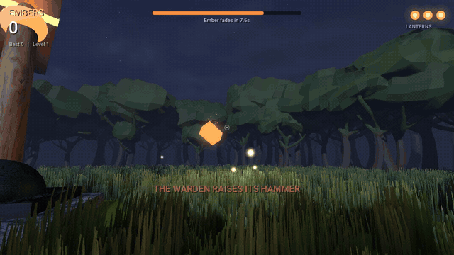
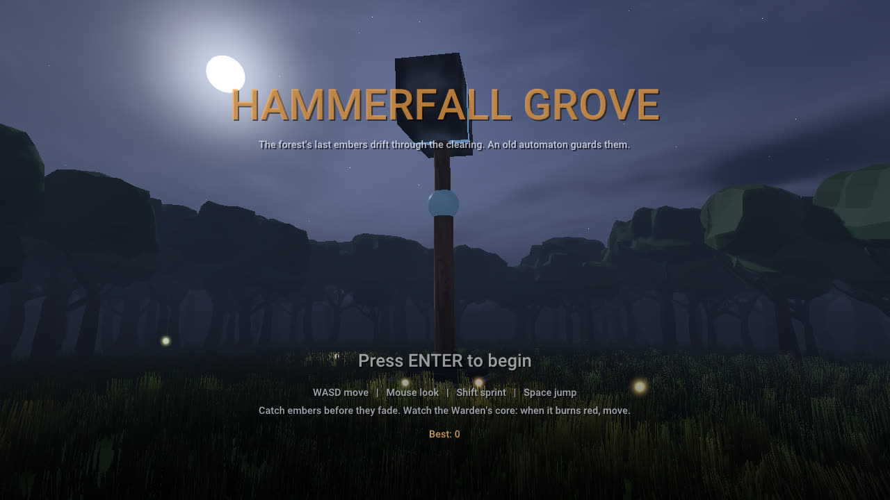
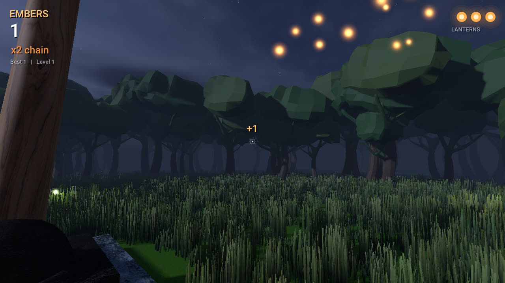

# Hammerfall Grove

A small first-person game built with C++ and OpenGL. You're in a forest clearing at night, guarded by a giant mechanical arm with a hammer. Glowing embers appear around the clearing and you have to grab them before they fade, while dodging the hammer.



[Watch the gameplay video (MP4)](docs/media/gameplay.mp4)

| | |
|---|---|
|  |  |

## How it plays

- One ember is active at a time and fades after a few seconds. Grabbing embers back to back builds a score multiplier (up to x5).
- The arm watches you, winds up, then slams the hammer where you were standing. Move during the wind-up to dodge it.
- You have three lives. Getting hit knocks you back and costs one.
- Every four embers the game speeds up: embers fade faster and the arm attacks sooner.

## What I worked on

**Graphics**
- Lighting with one moonlight that casts soft shadows, plus small point lights (fireflies, the ember, your lantern)
- Shadow mapping with soft edges (PCF)
- Thousands of grass blades and trees drawn with instancing, with grass that sways in the wind
- Night sky with stars, fog in the distance, and glowing sprites for fireflies and sparks

**Gameplay**
- The arm is a chain of parts (base, upper arm, forearm, hammer). When it attacks, it picks a strike pose from a small table based on how far away you are.
- A simple state machine for the arm: idle, tracking, wind-up, strike, recover
- Player movement with jumping, knockback and arena bounds
- A particle system for sparks and dust

**Code**
- Game logic is kept separate from the OpenGL code, so it can be unit tested
- CMake build and GitHub Actions CI that builds and runs the tests

## Controls

| Key | Action |
|---|---|
| WASD | Move |
| Mouse | Look around |
| Shift | Sprint |
| Space | Jump |
| Enter | Start |
| R | Restart |
| P | Pause |
| Esc | Quit |

## Building and running

Needs a C++17 compiler, CMake 3.20+, OpenGL 3.3+ and GLEW.

```bash
# macOS
brew install cmake glew glfw glm
# Ubuntu / Debian
sudo apt install cmake libglew-dev libglfw3-dev libglm-dev libgl1-mesa-dev

cmake -B build -DCMAKE_BUILD_TYPE=Release
cmake --build build -j
./build/hammerfall_grove          # run from the repo root
ctest --test-dir build            # run the tests
```

## Project structure

```
src/core/   math helpers, OBJ model loader
src/game/   arm, player, scoring, particles, world layout
src/gfx/    shaders, meshes, textures, renderer
src/ui/     HUD and menus
src/app/    window, main loop, input
shaders/    GLSL shaders
tests/      unit tests
```

More notes are in [docs/DESIGN.md](docs/DESIGN.md).

## Credits

The first version of this game was built together with **Elizabeth O'Meara**. I later reworked the engine and added more gameplay.

I learned most of the lighting and shadow techniques from [LearnOpenGL](https://learnopengl.com/). Libraries: GLFW, GLEW, GLM, Dear ImGui, stb, doctest.
